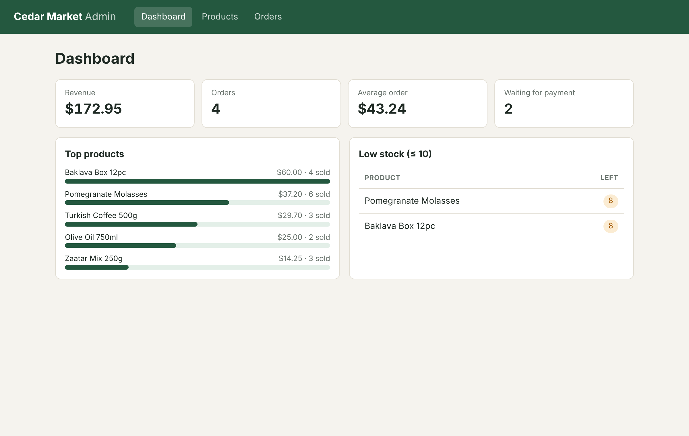
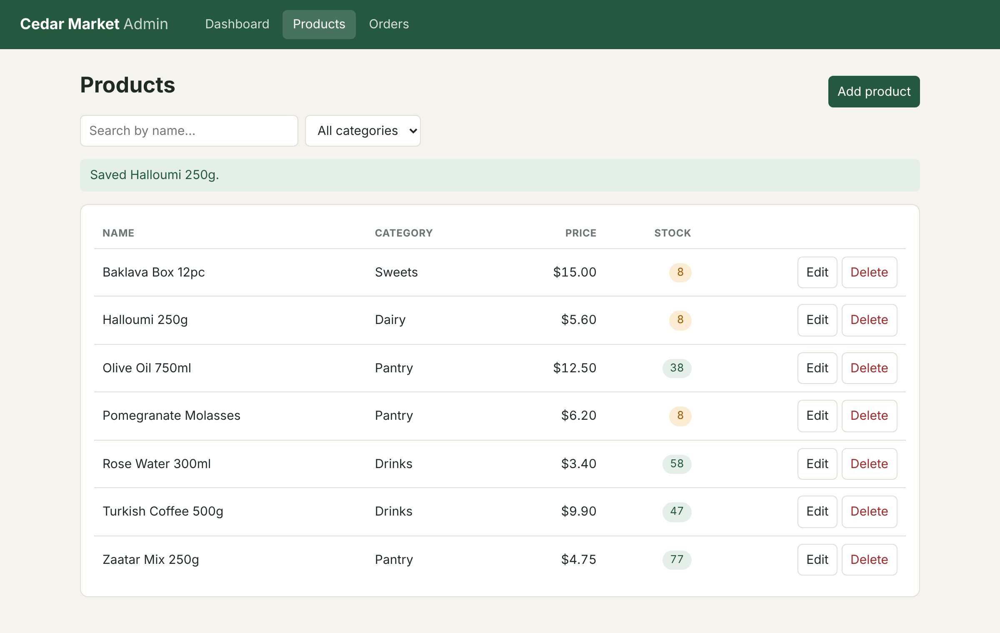
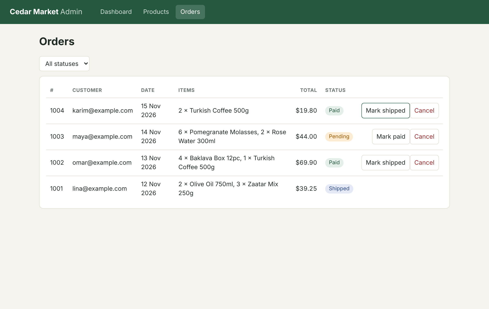

# Cedar Market Admin — Blazor

Back-office dashboard for a small online grocery store, built with **Blazor Server on .NET 8**.



## Features

- **Dashboard** — revenue, order count, average order value, top products and low-stock alerts
- **Products** — search, filter by category, add / edit / delete with form validation
- **Orders** — status workflow `Pending → Paid → Shipped`, with cancel at the right steps
- **Business rules** in one testable service:
  - placing an order reserves stock, cancelling gives it back
  - an order keeps the price from the time of purchase
  - a product that appears in an order cannot be deleted
- **Unit tests** with xUnit (12 tests)

| Products | Orders |
| --- | --- |
|  |  |

## Tech

C# 12 · .NET 8 · Blazor (interactive server rendering) · DataAnnotations validation · xUnit

## Run it

```bash
dotnet run --project src/StoreAdmin
```

Then open the URL printed in the terminal.

```bash
dotnet test
```

## Project structure

```
src/StoreAdmin
  Components/Pages     Dashboard, Products, Orders
  Components/Layout    Top navigation
  Models               Product, Order, OrderLine
  Services             StoreService (rules + data), SeedData
tests/StoreAdmin.Tests StoreService unit tests
```

Data is kept in memory and seeded on start, so the app runs with no database setup.
`StoreService` is the only class that touches data, so it can be replaced by an EF Core
or HTTP-backed implementation without changing the pages.

## Related projects

Part of a small set of projects around the same store:
an orders REST API (Spring Boot), a customer wishlist (Firebase), a storefront theme (Shopify),
and API tests + sales analytics (Postman, Power BI).
